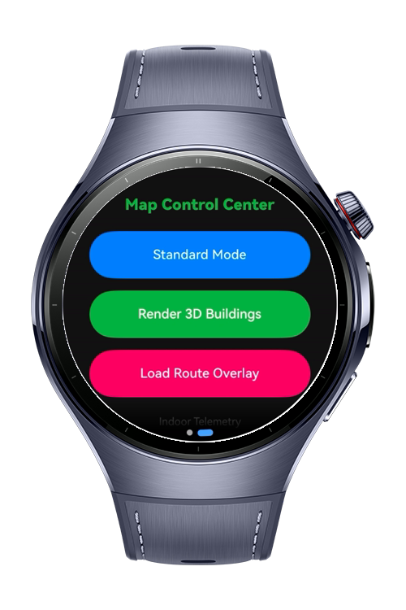
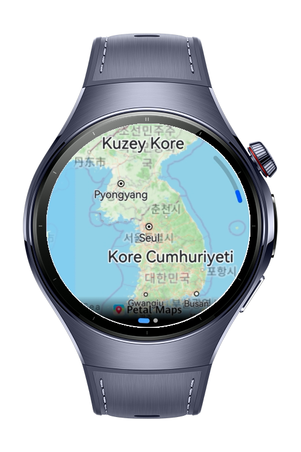
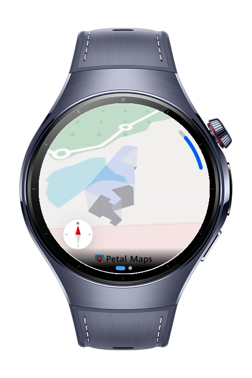
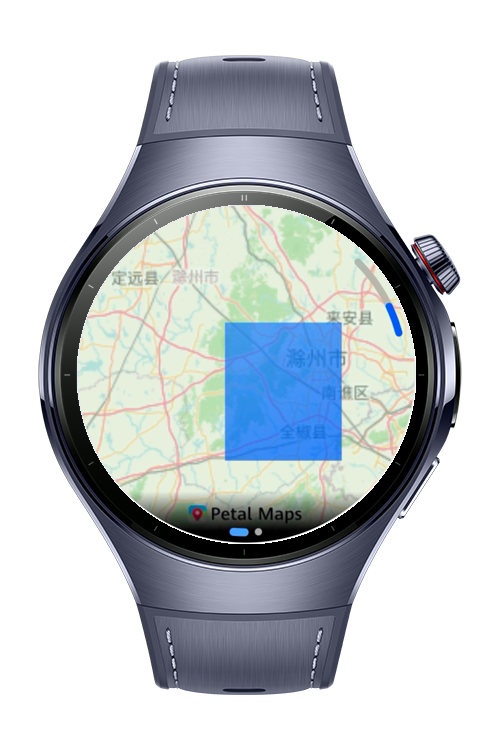

> **Note:** To access all shared projects, get information about environment setup, and view other guides, please visit [Explore-In-HMOS Index](https://github.com/Explore-In-HMOS/hmos-index).

# How to Build Custom Tile Layers

This project demonstrates how to leverage Huawei MapKit under the MVVM architecture to build a multi-layer wearable map application designed for specialized data visualization and custom geographic overlays.
By utilizing ArcSwiper, allowing fluid map camera control and list swiping via touch gestures or the physical Digital Crown.

The application focuses on rendering and controlling advanced spatial data layers directly on a wearable interface:

TileOverlay: Loads custom tile images (e.g., weather radar, terrain, satellite views) from remote or local servers, enabling seamless switching between topographic maps.

ImageOverlay: Places a single geo-referenced image (such as a specific hiking route map, trail path, or facility floor plan) perfectly onto the map surface.

BuildingOverlay: Generates 3D building footprints to provide urban navigation and structural spatial context.

IndoorMapInfo: Dynamically captures active indoor level and floor data for complex mall or airport wayfinding.

# Preview

<div>
  
  
  
  
</div>

# Use Cases

- Outdoor Trail Mapping: Use ImageOverlay to seamlessly display custom hiking routes or trail maps directly on top of the base map.

- Live Weather Tracking: Leverage TileOverlay to stream live rain radar and cloud imagery from remote servers onto your wrist.

- 3D Urban Navigation: Enable BuildingOverlay to render city landmarks and structures in 3D for enhanced spatial awareness.

- Indoor Wayfinding: Utilize IndoorMapInfo to auto-switch to floor-level plans when navigating inside complex malls or airports.

# Tech Stack

- **Languages:** ArkTS
- **Frameworks:** HarmonyOS SDK, API version 6.0.1
- **Tools:** DevEco Studio 6.0.1 or later
- **Libraries & Kits:**
  - `@kit.PerformanceAnalysisKit`
  - `@kit.ArkUI`
  - `@kit.AbilityKit`
  - `@kit.MapKit`
  - `@kit.BasicServicesKit`

# Directory Structure

```
├── entry/
│   └── src/
│       └── main/
│           └── ets/
│               ├── models/
│               │   └── MapState.ets
│               ├── pages/
│               │   └── Index.ets
│               └── viewmodels/
│                   └── MapViewModel.ets
└── resources/
    └── rawfile/
        └── icon/
            └── icon.png
     
```

# Constraints and Restrictions

- Please enable Map Kit in AGC.
- Before building the project, please set the URL of the TileOverlay. (TILE_OVERLAY_URL)

## Supported Devices

- HarmonyOS wearable Watch 5

# License

**how-to-build-custom-tile-layers** is distributed under the terms of the MIT License.
See the [LICENSE](./LICENSE) for more information.